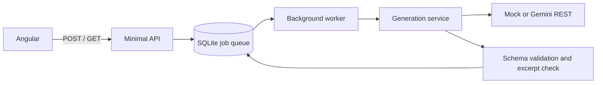

# LearnSphere · Training studio

A C#/.NET 10 API and Angular 21 app that turns a course transcript into a summary and a five-question quiz. Each answer includes an excerpt checked against the submitted source. Managers can answer the quiz, reveal the key, review evidence, revisit history, and delete completed material.

**Runs without an API key in Mock mode.** Mock questions are deterministic demonstrations, not evidence of AI quality. Gemini mode uses a real hosted model; both synthetic samples were successfully exercised on `gemini-3.8-flash` on 2026-10-17.

## Quick start

### Docker (recommended)

Install and start Docker with Linux containers, then run from the repository root:

```sh
docker compose up --build -d --wait
```

Open **http://localhost:8080**, select **Load sample**, then **Create learning material**. The MOCK OUTPUT banner identifies demo output. Check answers or reveal the answer key to inspect explanations and source excerpts. Compose binds to localhost only.

```sh
docker compose down          # preserves history
docker compose up -d --wait  # reconnects the named SQLite volume
# docker compose down -v     # deliberately deletes all stored material
```

The runtime uses non-root UID 1654 and a persistent `/app/App_Data` volume. Its healthcheck calls `/health` through the application's `--healthcheck` mode, so no curl installation is required in the image.

### Local development

Prerequisites: .NET SDK 10.0.401 (or a compatible later feature band), Node 24 LTS, npm. The tested versions are pinned through `global.json` and `package-lock.json`.

```sh
npm --prefix src/LearnSphere.Web ci
npm --prefix src/LearnSphere.Web run build
dotnet run --project src/LearnSphere.Api
```

Open **http://localhost:5080**. Angular's build writes browser files directly into the API's ignored `wwwroot` folder. `dotnet build` intentionally does not invoke npm. For frontend hot reload, keep the API running and use a second terminal:

```sh
npm --prefix src/LearnSphere.Web start
```

Open **http://localhost:4200**. The Angular proxy forwards `/api/**` to port 5080. There is no cross-origin production API. Local SQLite is in `src/LearnSphere.Api/App_Data/learnsphere.db` when using `dotnet run`.

### Gemini live mode

Create your own key in [Google AI Studio](https://aistudio.google.com/apikey). Free availability depends on model, account, region, and quotas; check [pricing](https://ai.google.dev/gemini-api/docs/pricing) and your console. A successful model-list request alone does not prove a model permits generation: `gemini-2.5-flash` was listed but rejected for this account. The tested model was `gemini-3.8-flash`.

For Docker, copy `.env.example` to `.env`, fill in your own values locally, then recreate the service:

```text
LLM_PROVIDER=Gemini
GEMINI_API_KEY=<your own key>
LLM_MODEL=gemini-3.8-flash
```

```sh
docker compose up -d --force-recreate --wait
```

For local development, use backend user secrets, then restart `dotnet run`:

```sh
dotnet user-secrets set "Llm:Provider" "Gemini" --project src/LearnSphere.Api
dotnet user-secrets set "Llm:Model" "gemini-3.8-flash" --project src/LearnSphere.Api
dotnet user-secrets set "Llm:ApiKey" "<your own key>" --project src/LearnSphere.Api
```

Alternatively use environment variables `Llm__Provider`, `Llm__Model`, `Llm__ApiKey`. Never put keys in Angular, committed configuration, or AI chats. No shared key is included. Missing live configuration fails at startup. To return to Mock locally, remove the live user secrets or set `Llm:Provider` to `Mock`.

## API

| Method | Route | Behavior |
|---|---|---|
| POST | `/api/v1/generations` | `{ "title"?: string, "transcript": string }` → 202 with `{ id, status: "Queued" }` and Location |
| GET | `/api/v1/generations/{id}` | Job status, summary, questions, metadata, safe terminal error |
| GET | `/api/v1/generations?limit=20` | Newest first; limit 1–100; no transcripts or generated bodies |
| DELETE | `/api/v1/generations/{id}` | 204; 409 while Processing; 404 if absent |
| GET | `/health` | Application/SQLite health |
| GET | `/openapi/v1.json`, `/scalar/v1` | OpenAPI and interactive reference |

```sh
curl -i http://localhost:8080/api/v1/generations \
  -H "Content-Type: application/json" --data-binary @samples/request.json
curl http://localhost:8080/api/v1/generations/<returned-id>
```

In PowerShell use `curl.exe` to avoid its legacy curl alias. Job states are `Queued → Processing → Succeeded | Failed`. A succeeded response contains `summary: { overview, keyPoints }`, five `questions`, `generationMode`, and `metadata`. A question has `prompt`, four `options`, zero-based `correctAnswerIndex`, `explanation`, `sourceExcerpt`, and `excerptVerified`. See [the recorded live outputs](samples/recorded-gemini-run.json) for complete examples. The answer key is included because this is an authoring tool for managers, not a secure learner assessment API.

Request failures return Problem Details with `traceId`: 400 for invalid JSON/content type/fields, 413 for a body over 1 MiB, 503 when 20 jobs are pending, and 404/409 as above. Provider failures are **terminal job results returned by GET with HTTP 200**, not failed polling HTTP responses. Examples: `provider_rate_limited`, `provider_unavailable`, `provider_timeout`, `provider_auth_failed`, `provider_refused`, `provider_truncated`, `provider_invalid_output`, `insufficient_content`, `input_too_large`, and `interrupted`. Error messages never include raw provider text.

## Architecture and decisions



- **Async jobs, database as queue:** the API commits a Queued row before returning 202. A signal wakes the worker; a five-second scan handles lost signals. Claims use a conditional SQL update, so only one contender claims a given row. Default concurrency is one. Admission is serialized within this single-process deployment to enforce the pending-job cap.
- **Restart behavior:** Queued jobs remain available. Processing jobs become Failed/interrupted on startup and clear their transcripts. They are never automatically rerun. This avoids hidden duplicate inference calls; a crash after inference but before persistence can still lose that result. Multi-host deployment is unsupported because startup recovery has no distributed ownership lease.
- **One backend project:** logical Domain/Generation folders contain no ASP.NET or EF references; adapters, persistence, jobs, and endpoints surround them. An app-owned ILlmClient isolates the dependency without adding a multi-provider SDK framework.
- **Native Gemini REST:** countTokens and generateContent, server-side `x-goog-api-key`, responseJsonSchema, explicit finish reasons, thought-part filtering, and nullable usage metadata. No external tools or secrets are supplied in the generation prompt. [Structured output docs](https://ai.google.dev/gemini-api/docs/generate-content/structured-output), [token API](https://ai.google.dev/api/tokens).
- **One generation call plus optional repair:** invalid JSON or validation errors allow exactly one schema repair. Refusal, safety block, truncation, empty output, and insufficient source content fail without repair. Repair input is budget-checked again.
- **Fixed quiz:** five questions/four options; distinct prompts/options, required fields, valid indices, 3–8 key points, and nonempty explanations. Missing answer indices cannot silently become zero. English output is an explicit POC limit.
- **Source evidence:** preserve the submitted text, trimmed only. Normalize NFKC, case, whitespace, quotes, and dashes on both source and excerpts; use substring matching, never fuzzy matching. Unmatched excerpts are flagged, not fatal. A match proves provenance only; managers still check factual correctness and context. Invariant uppercasing is an approximation of Unicode case folding, adequate for the stated English scope.
- **SQLite:** EnsureCreated, with no migrations. Immutable content/metadata records are serialized into JSON TEXT columns rather than EF owned graphs; replacement-only persistence avoids complex tracking. Changing the schema requires an explicit database reset for this POC. UTC timestamps retain UTC markers after SQLite round trips.
- **Angular:** standalone components, reactive forms, HttpClient, local signals, and RxJS polling. Polling stops at terminal states and route destruction. Retry resubmits from an in-memory browser draft; after reload it returns to the form. No transcript is persisted in browser storage.
- **Docker:** Node build, .NET publish, non-root ASP.NET runtime; localhost-only port and one named SQLite volume. `global.json` selects .NET 10, a deliberate update from the brief's suggested .NET 8 baseline.

**No automatic retries on provider errors. On a free tier, retrying a rate-limit error just burns quota, so the app fails fast and the UI offers a Retry button.** Token counting is a separate preparatory call, not a transport retry. A schema repair is a bounded additional generation request only for fixable output drift.

## Limits, privacy, and operational behavior

Configuration lives in `src/LearnSphere.Api/appsettings.json` and is validated at startup:

| Setting | Default |
|---|---|
| `Generation:MinTranscriptChars` / `MaxTranscriptChars` | 500 / 200,000 trimmed characters |
| `Generation:MaxInputTokens` | 100,000 |
| `Generation:QuestionCount` / `OptionsPerQuestion` | 5 / 4 (fixed POC shape) |
| `Generation:MaxExcerptWords` | 40 |
| `Generation:MaxConcurrentJobs` / `MaxPendingJobs` | 1 / 20 |
| `Llm:TimeoutSeconds` / `MaxOutputTokens` | 120 per request / 8,192 output tokens |
| `Llm:ThinkingBudget` | null (omit field; model decides) |

The overall service deadline is three times the per-call timeout and includes counting and repair. Reserve context for system instructions, schema, and output when changing model or token caps. No silent truncation and no chunking. If countTokens fails, the implementation deliberately uses **four tokens per UTF-16 code unit plus prompt headroom**, more conservative than the plan's chars/4 heuristic. This can reject a long transcript when the count is unavailable; it does not promise exact token safety across arbitrary models. Operators must configure limits within their chosen model's context.

**Verified live range:** the included 1,483-character and 46,152-character samples succeeded. The 200,000-character cap is provisional, not a verified support claim. The long fixture repeats modules; it is a context/transport smoke test. Results, metrics, and factual review are recorded in [recorded-gemini-run.json](samples/recorded-gemini-run.json). Approximate latencies were 8.5/8.0 seconds, input usage 442/8,185 tokens, output usage 878/783 tokens, no repair, all ten excerpts matched. Missing token usage remains null. Recorded Stop finish reasons are inferred from the service's successful Stop-only path on that run.

Transcripts are cleared when a job completes or becomes interrupted. Results, title, length, and SHA-256 remain until deletion. SQLite journals, backups, and browser memory may retain past content; nulling/deleting is not a secure-erasure guarantee. Live mode sends transcript data to Google; use synthetic or approved material and check the applicable [Gemini terms](https://ai.google.dev/gemini-api/terms), especially free-service data use.

Application logs contain IDs, status, timings, model, usage, and failure categories. They never intentionally log transcripts, prompts, model output, provider bodies, or keys, including Debug. Typed-provider HTTP logging is removed. Generated text is rendered through Angular interpolation, never innerHTML. Prompt separation and independent checks mitigate injection but cannot guarantee factual or instruction safety.

There is no authentication or tenant isolation. Run locally. Public hosting needs access controls, rate limits, and spending controls. The UI remembers in-flight retry drafts until the tab closes or material is deleted. Public GitHub source publication is distinct from public hosting and is a separate delivery step.

## Verification

```sh
dotnet build LearnSphere.sln -warnaserror
dotnet test LearnSphere.sln
npm --prefix src/LearnSphere.Web ci
npm --prefix src/LearnSphere.Web test -- --watch=false
npm --prefix src/LearnSphere.Web run build
node --test scripts/archive-safety.test.cjs
node scripts/check-secrets.cjs
docker compose config --quiet
docker compose up --build -d --wait
docker compose exec -T api id -u
```

Tests cover validation, required fields, bounded repair, excerpts, usage, provider wire format/errors/timeouts, real SQLite queue/worker integration, interrupted startup, pending-job cap, terminal transcript cleanup, malformed/oversized requests, unknown API routes, health/OpenAPI, quiz scoring, markup-as-text, polling, and duplicate-submit prevention. Test providers require no key. Packaging checks exercise the real SPA routes and named-volume persistence across container replacement.

No connected browser was available for a manual visual/click-through inspection; Angular component checks and HTTP packaging smoke checks are recorded separately from human browser QA. Before submission, review mobile/desktop layout and complete the quiz once in your browser.

## Trade-offs and future work

The final plan expands beyond the initial eight-hour guide with Angular, durable jobs, grounding excerpts, and Docker. This remains a local single-instance POC. Future work: token-aware map/reduce for larger input, SSE progress, authentication/tenant isolation, retention expiry, idempotency, distributed job leases, a Groq/OpenAI adapter, editable questions, learner-safe endpoints, LMS exports, video transcription, and broader factual-quality evaluation. No SCORM support, streaming, or arbitrary-length guarantee is implied.

## AI assistance and logs

Claude Code and OpenAI Codex were used for planning and comparison. Codex implemented the API, Angular UI, tests, Docker packaging, and documentation, and ran mock/live checks. Reviewers should inspect both the code and decisions; generated content still needs human review.

See [AI-LOGS.md](AI-LOGS.md) and [Context/README.md](Context/README.md). **Publication copies redact a credential supplied in chat and omit internal reasoning; they are not literally unedited exports.** Originals remain in the local tools' session stores. The supplied key should be rotated before submission. No secret is bundled with the app.
